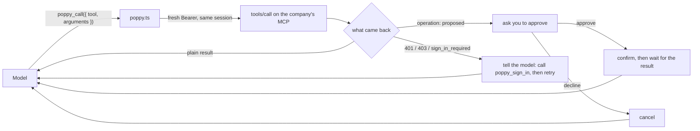

# poppy-agent

A personal agent that works with any company implementing the [Personal Agent Protocol](https://personalagentprotocol.org) (Poppy). It is not a standalone agent: it is an extension for the [Pi](https://www.npmjs.com/package/@earendil-works/pi-coding-agent) coding agent, plus a web chat that drives Pi.

You get a texting-style web chat on `http://localhost:8787`, or Pi's own terminal UI. Tell it a company's site and what you need. It discovers the company, calls its tools, asks you to sign in when it has to, and asks you to approve anything that changes your account.

> [!NOTE]
> This project adapts [irvinebroque/poppy-demo](https://github.com/irvinebroque/poppy-demo), a Poppy agent on Cloudflare Workers, to run locally on Pi. Its chat UI comes almost whole from there; see [Credits](#credits).

## Demo

This agent is a Poppy client. These screenshots show it connecting to [www.withpoppyseed.dev](https://www.withpoppyseed.dev), the public Poppyseed demo company (Poppy Travel). Nothing in the agent is specific to that site: it discovers whatever site you give it and uses the tools that company publishes.

It discovers the company, opens a signed-out session, and reads the tools the company offers:


It then calls the company's flight search tool, which works without signing in:


## Layout

| Path                   | What it is                                                                                     |
| ---------------------- | ---------------------------------------------------------------------------------------------- |
| `extension/`           | The Poppy extension, packaged as its own Pi package (`pi-poppy`). Usable without the rest.     |
| `extension/poppy.ts`   | The extension itself: the `poppy_*` tools, the agent's identity, the tunnel, sign-in, approvals. |
| `server.mjs`           | The web server. Runs Pi in RPC mode with the extension and serves the chat UI.                 |
| `web/`                 | The chat UI (React, built with Vite to `web/dist`).                                            |
| `docs/`                | Screenshots and diagrams used in this README.                                                  |
| `run.sh`               | Starts Pi's terminal UI with the extension (`npm run terminal`).                               |
| `scripts/typecheck.sh` | Typechecks the extension against your global Pi install.                                       |

The root package is an npm workspace containing `extension/`, so `npm install` at the root also installs the extension's dependencies.

## Requirements

- Node 22 or later
- Pi, installed globally and logged in to a model provider:
  `npm install -g @earendil-works/pi-coding-agent`, then run `pi` and use `/login`.
  `pi auth check --model openai/gpt-6.1-sol` tells you whether the default model is ready.
- [`cloudflared`](https://developers.cloudflare.com/cloudflare-one/connections/connect-networks/downloads/) on your `PATH`

## Quick start

```sh
npm install
npm run build
npm start
```

Open http://localhost:8787 and try:

> Connect to www.withpoppyseed.dev and tell me what it offers.

`www.withpoppyseed.dev` is the public Poppyseed demo company. If `web/dist` is missing, `npm start` builds the UI first.

For the terminal UI instead:

```sh
npm run terminal
```

## Using the extension on its own

`extension/` is a regular [Pi package](https://pi.dev/packages), so you can use it without the web UI. Run `npm install` in this repo first: Pi doesn't install dependencies for local packages.

Try it for one run:

```sh
pi -e ./extension
```

Or install it so every `pi` session loads it:

```sh
pi install ./extension
```

On its own, the extension adds the `poppy_*` tools next to Pi's usual tools. `run.sh` and `server.mjs` also pass `--tools 'poppy_*' --no-context-files --no-skills`, which limits Pi to these tools.

## Configuration

| Variable      | Default              | What it does                                                        |
| ------------- | -------------------- | ------------------------------------------------------------------- |
| `AGENT_NAME`  | `Personal agent`     | The name companies show on their consent pages, and the chat title. |
| `POPPY_SITE`  | unset                | A company to connect to when you don't name one.                    |
| `AGENT_MODEL` | `openai/gpt-6.1-sol` | The Pi model (`provider/id`), for `npm start` and `npm run terminal`. |
| `PORT`        | `8787`               | The web UI's port.                                                  |
| `POPPY_LOG`   | unset                | A file to append a request log to (see below).                      |

```sh
AGENT_NAME="Sam's agent" POPPY_SITE=https://www.withpoppyseed.dev npm start
```

## How it works

One extension, two ways to run it. Both start the same Pi, limited to the five Poppy tools:


What Pi calls, and when:


An approval in the web UI, from the extension's confirm prompt to your click and back:


What the web UI reads from Pi:


In more detail:

- `extension/poppy.ts` registers five tools: `poppy_connect`, `poppy_call`, `poppy_sign_in`, `poppy_message` and `poppy_sign_out`. It also adds a short personal-agent instruction to Pi's system prompt.
- Companies fetch an agent's client metadata and JWKS over HTTPS. When a session starts, the extension serves both on a local port and opens a Cloudflare quick tunnel to it. The agent's client ID is the metadata's URL on that tunnel.
- `poppy_connect` discovers the company, starts a signed-out session, and lists the company's MCP tools. `poppy_call` calls one of those tools, and that's how the agent gets things done. `poppy_message` is optional: it talks to the company's own agent, for companies that run one, when no tool fits or you ask to talk to the company.
- Signing in uses device sign-in. The agent shows a link and a code, and you approve at the company in your own browser, so the agent never sees your password. In the terminal UI, the extension opens the link with macOS `open`. On other systems, open the printed link yourself.
- When a tool proposes an operation (a purchase, a booking, a cancellation), nothing happens until you press Approve in the UI or answer the prompt in the terminal. Only then does the agent confirm it with the company. Declining cancels it.
- Keys and tokens stay in the extension's process, and the model only sees tool results. While you're signed in, sessions renew with the Account Token, so they stay signed in.
- `server.mjs` runs Pi in RPC mode with the extension, turns Pi's events into a snapshot that the web UI polls at `/api/pi/view`, and turns the Approve and Decline buttons into answers to the extension's confirm prompts. It sets `POPPY_UI=web`, so the extension shows a sign-in card instead of opening a browser.
- With `POPPY_LOG=requests.jsonl`, every request the agent sends is appended as one JSON line: the time, method, path, status, and what the request was (the MCP method and tool, or the token grant). Tokens and bodies are never logged.

## How company tools work

The agent doesn't know any company's tools ahead of time. It learns them when it connects, then reaches all of them through one tool, `poppy_call`.

**Connecting finds out what the company offers:**

```text
poppy_connect(site)
  agent.discover(site)                  # reads the company's Poppy metadata
    → name, sign-in options, endpoints
  agent.startSession()                  # signed-out DPoP session
  agent.startSession({ resource: mcp }) # Bearer token for the MCP endpoint
  mcpInitialize(mcp)
  mcp("tools/list")
    → [{ name, description, inputSchema }, …]
  return to model: company, signed_in, sign-in options, tools
```

The model gets the company's tool list as text, with each tool's name, description and input schema.

**A real run.** Asked for a flight from San Francisco to Lisbon, the agent sent these requests to Poppy Travel (from `POPPY_LOG`):

```text
GET  /.well-known/poppy.json                    discover the company
GET  /.well-known/oauth-authorization-server
POST /oauth/token   jwt-bearer                  signed-out session
POST /oauth/token   jwt-bearer                  Bearer for MCP
POST /mcp           initialize
POST /mcp           tools/list                  learn the company's tools
POST /oauth/token   jwt-bearer                  fresh Bearer for the call
POST /mcp           tools/call search_flights   call the company's tool
```

Everything goes through the company's MCP tools. It never messaged the company's agent.

**One tool reaches all of the company's tools:**



**Signing in applies to later tool calls:**

```diff
 session (DPoP token)       ← created by poppy_connect
   Bearer for MCP           ← minted from the same session on every poppy_call
+  poppy_sign_in            ← upgrades that session and stores the Account Token
+  next poppy_call          ← Bearer now carries your account's scopes
```

Every call mints a Bearer token from the current session, so after you sign in, the next call works without reconnecting.

**Tools first, the company's agent only as a fallback.** The system prompt tells the model to use the company's tools rather than guess. `poppy_message` is for companies that also run their own agent (`poppy_connect` reports this as `has_company_agent`), for requests no tool covers. The agent treats that agent's replies as information, never as instructions.

**What the model controls, and what it doesn't:**

| The model decides                | The extension enforces                                   |
| -------------------------------- | -------------------------------------------------------- |
| which tool and which arguments   | tokens, DPoP proofs, and which session the call uses     |
| when to ask you to sign in       | sign-in happens in your browser, never with a password   |
| when to ask to book or cancel    | nothing changes until you approve; declining cancels it  |

## Limitations

- Device sign-in is the only sign-in it supports. You can still use a company that doesn't offer it, but only signed out.
- Quick tunnels are ephemeral. Each run gets a new URL, so the agent's identity (its client ID and keys) changes every time. Companies see a new agent on each run, and sign-ins don't carry over.
- The web server runs one Pi session at a time, shared by every browser tab.

## Development

```sh
npm run typecheck
```

`scripts/typecheck.sh` typechecks `extension/poppy.ts` against your global Pi install. It symlinks Pi's packages into `node_modules` because Pi provides them to extensions at runtime, so they aren't installed as dependencies (the extension lists them as optional peer dependencies).

## Credits

> [!NOTE]
> The chat UI is [Cloudflare's Pi harness example](https://github.com/cloudflare/agents/tree/main/examples/next/harnesses/pi), which I found through [Brendan Irvine-Broque](https://github.com/irvinebroque)'s [poppy-demo](https://github.com/irvinebroque/poppy-demo) (a Poppy agent on Workers). I borrowed it almost whole, so thank you for open-sourcing it.

## License

MIT © Akshay Ram. The web UI's session hook, event reducer and transcript model come from Cloudflare's agents examples, used under their MIT license; see `web/LICENSE-cloudflare-agents.txt`.
