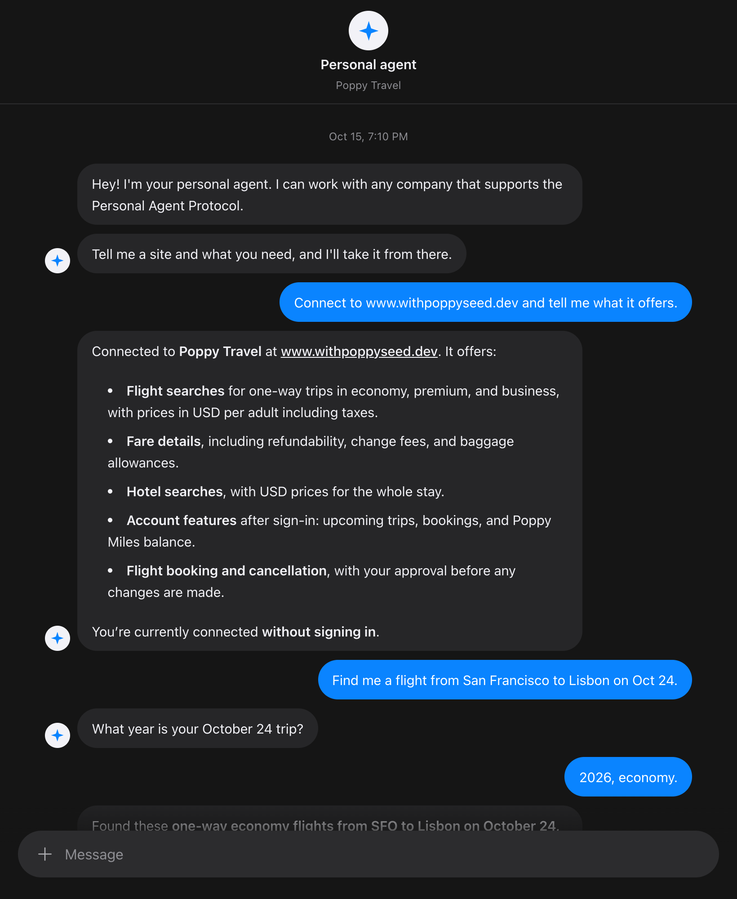
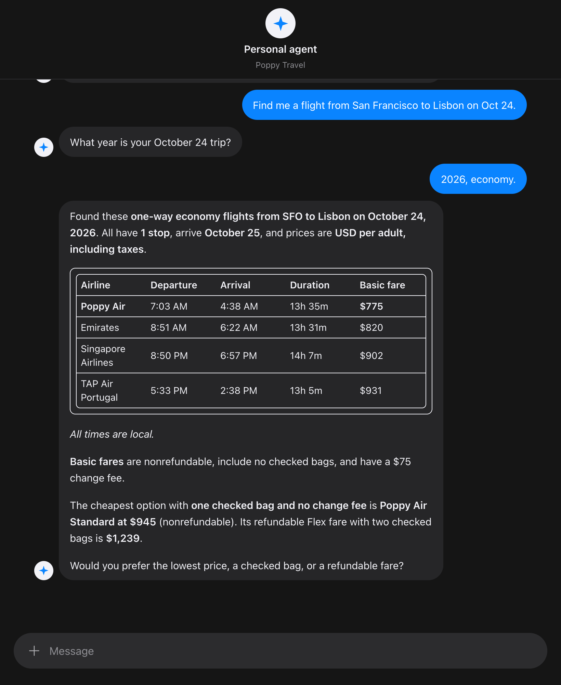
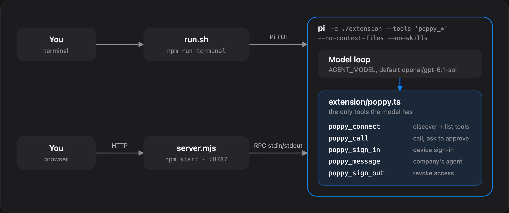
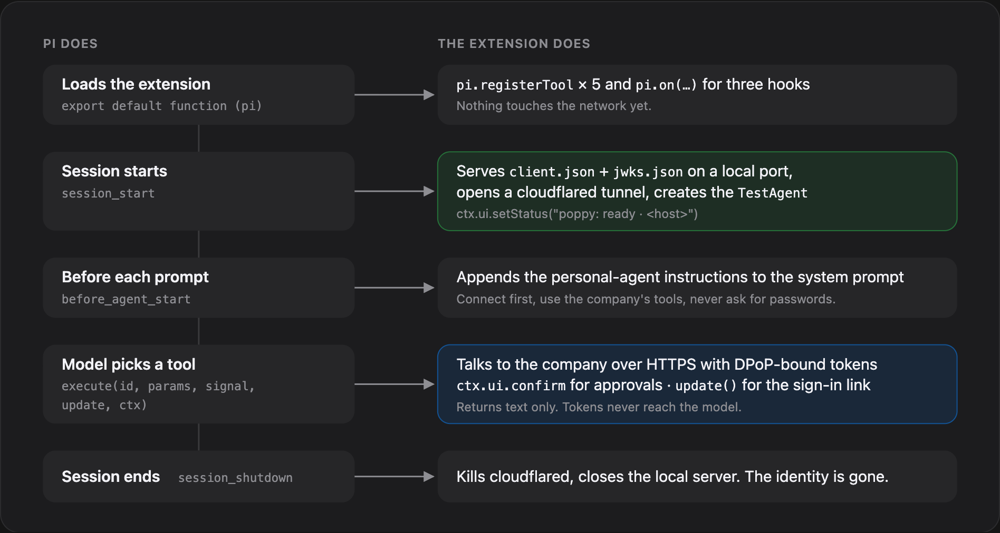
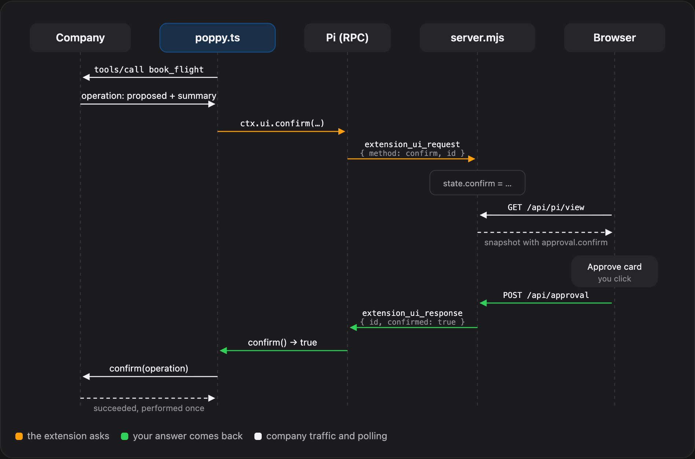
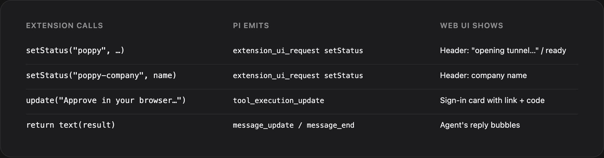
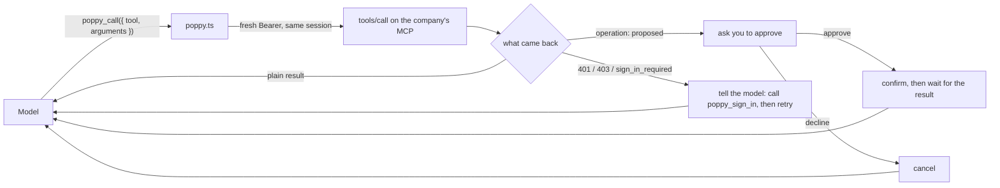

# poppy-agent

A personal agent for any company that implements the [Personal Agent Protocol](https://personalagentprotocol.org) (Poppy). It's an extension for the [Pi](https://www.npmjs.com/package/@earendil-works/pi-coding-agent) coding agent, plus a texting-style web chat that drives Pi.

Give it a company's site and what you need. It discovers the company, calls its tools, asks you to sign in when needed, and asks you to approve anything that changes your account.

Adapted from [irvinebroque/poppy-demo](https://github.com/irvinebroque/poppy-demo) (Poppy on Cloudflare Workers) to run locally on Pi. See [Credits](#credits).

## Demo

Connecting to [www.withpoppyseed.dev](https://www.withpoppyseed.dev), the public Poppyseed demo company (Poppy Travel). Nothing in the agent is specific to it.





## Quick start

Requirements:

- Node 22+
- Pi, installed globally and logged in: `npm install -g @earendil-works/pi-coding-agent`, then `pi` → `/login`. Check the default model with `pi auth check --model openai/gpt-6.1-sol`.
- [`cloudflared`](https://developers.cloudflare.com/cloudflare-one/connections/connect-networks/downloads/) on your `PATH`

```sh
npm install
npm start          # builds web/dist if missing, serves http://localhost:8787
npm run terminal   # or: Pi's terminal UI
```

Then try:

> Connect to www.withpoppyseed.dev and tell me what it offers.

## Configuration

| Variable      | Default              | Purpose                                                     |
| ------------- | -------------------- | ----------------------------------------------------------- |
| `AGENT_NAME`  | `Personal agent`     | Name shown on companies' consent pages and the chat title.  |
| `POPPY_SITE`  | unset                | Company to connect to when you don't name one.              |
| `AGENT_MODEL` | `openai/gpt-6.1-sol` | Pi model (`provider/id`).                                   |
| `PORT`        | `8787`               | Web UI port.                                                |
| `POPPY_LOG`   | unset                | File to append a JSONL request log to.                      |

```sh
AGENT_NAME="Sam's agent" POPPY_SITE=https://www.withpoppyseed.dev npm start
```

## Using the extension on its own

`extension/` is a standalone [Pi package](https://pi.dev/packages) (`pi-poppy`). Run `npm install` here first; Pi doesn't install dependencies for local packages.

```sh
pi -e ./extension        # one run
pi install ./extension   # every session
```

This adds the `poppy_*` tools alongside Pi's built-ins. `run.sh` and `server.mjs` additionally pass `--tools 'poppy_*' --no-context-files --no-skills` to restrict Pi to them.

## How it works





- **Tools.** `extension/poppy.ts` registers `poppy_connect`, `poppy_call`, `poppy_sign_in`, `poppy_message` and `poppy_sign_out`, and adds a short personal-agent instruction to the system prompt.
- **Identity.** Companies fetch the agent's client metadata and JWKS over HTTPS. On session start the extension serves both locally behind a Cloudflare quick tunnel; the client ID is the metadata URL on that tunnel.
- **Sign-in.** Device flow: the agent shows a link and code, you approve in your own browser, the agent never sees your password. The terminal UI opens the link with macOS `open`; elsewhere, open it yourself.
- **Approvals.** Proposed operations (purchase, booking, cancellation) wait until you approve in the UI or terminal prompt. Declining cancels.
- **Secrets.** Keys and tokens stay in the extension process; the model only sees tool results. Sessions renew with the Account Token, so you stay signed in.
- **Web server.** `server.mjs` runs Pi in RPC mode, folds its events into a snapshot the UI polls at `/api/pi/view`, and maps Approve/Decline to the extension's confirm prompts. It sets `POPPY_UI=web` so sign-in shows a card instead of opening a browser.
- **Logging.** `POPPY_LOG=requests.jsonl` appends one line per request: time, method, path, status, and kind (MCP method/tool or token grant). Never tokens or bodies.





### Company tools

The agent knows no company's tools ahead of time. `poppy_connect` learns them; `poppy_call` reaches all of them.

```text
poppy_connect(site)
  agent.discover(site)                  # Poppy metadata → name, sign-in options, endpoints
  agent.startSession()                  # signed-out DPoP session
  agent.startSession({ resource: mcp }) # Bearer for the MCP endpoint
  mcpInitialize(mcp)
  mcp("tools/list")                     # → [{ name, description, inputSchema }, …]
```



Every `poppy_call` mints a fresh Bearer from the current session, so after `poppy_sign_in` upgrades the session, the next call carries your account's scopes without reconnecting.

A real flight search against Poppy Travel (from `POPPY_LOG`):

```text
GET  /.well-known/poppy.json                    discover
GET  /.well-known/oauth-authorization-server
POST /oauth/token   jwt-bearer                  signed-out session
POST /oauth/token   jwt-bearer                  Bearer for MCP
POST /mcp           initialize
POST /mcp           tools/list
POST /oauth/token   jwt-bearer                  fresh Bearer for the call
POST /mcp           tools/call search_flights
```

`poppy_message` is a fallback for companies that run their own agent (`has_company_agent`), for requests no tool covers. Its replies are treated as information, never instructions.

| The model decides              | The extension enforces                                 |
| ------------------------------ | ------------------------------------------------------ |
| which tool and arguments       | tokens, DPoP proofs, which session a call uses         |
| when to ask you to sign in     | sign-in happens in your browser, never with a password |
| when to ask to book or cancel  | nothing changes until you approve                      |

## Limitations

- Device sign-in only. Companies without it work signed-out only.
- Quick tunnels are ephemeral: each run gets a new client ID and keys, so companies see a new agent and sign-ins don't carry over.
- The web server runs one Pi session, shared by all tabs.

## Layout

| Path                   | What                                                                       |
| ---------------------- | -------------------------------------------------------------------------- |
| `extension/poppy.ts`   | The extension: tools, identity, tunnel, sign-in, approvals.                |
| `server.mjs`           | Web server: runs Pi in RPC mode and serves the UI.                         |
| `web/`                 | Chat UI (React + Vite → `web/dist`).                                       |
| `run.sh`               | Pi terminal UI with the extension.                                         |
| `scripts/typecheck.sh` | Typechecks the extension against your global Pi install.                   |
| `docs/`                | README images.                                                             |

The root is an npm workspace containing `extension/`.

## Development

```sh
npm run typecheck
```

Pi provides its packages to extensions at runtime (they're optional peer deps), so `scripts/typecheck.sh` symlinks them from your global Pi install into `node_modules`.

## Credits

The chat UI is [Cloudflare's Pi harness example](https://github.com/cloudflare/agents/tree/main/examples/next/harnesses/pi), found via [Brendan Irvine-Broque](https://github.com/irvinebroque)'s [poppy-demo](https://github.com/irvinebroque/poppy-demo). Borrowed almost whole; thanks for open-sourcing it.

## License

MIT © Akshay Ram. The web UI's session hook, event reducer and transcript model come from Cloudflare's agents examples (MIT); see `web/LICENSE-cloudflare-agents.txt`.
